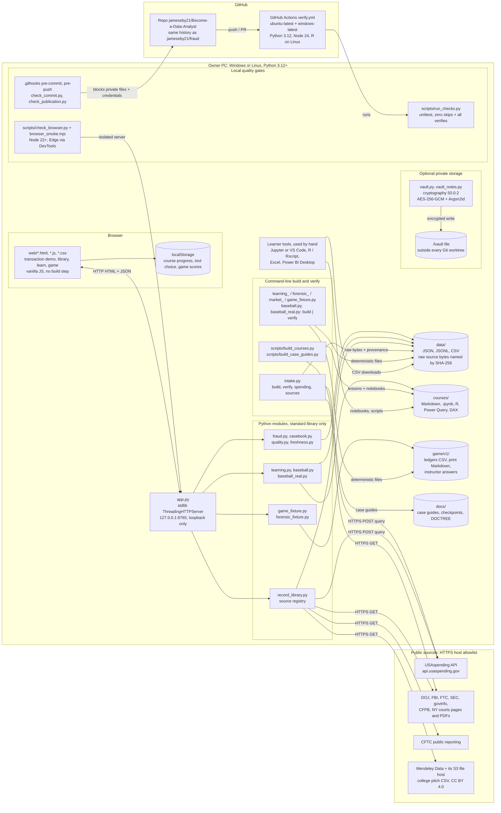

# Become a Data Analyst architecture

Snapshot of `main` at commit `d178670` (2026-10-22, checkpoint CP-017). The GitHub repository is `jameseby21/Become-a-Data-Analyst`; it is the same repository that was first published as `jameseby21/Fraud` (identical 25-commit history and file tree). The README and page titles still use the name "Fraud". Counts below are the ones recorded in `README.md` at CP-017. Each Mermaid block below also has a `.mmd` source and an `.svg` render in [`architecture/`](architecture/): `infrastructure`, `functionality`.

## Summary

This is a local, open-source workbench for learning fraud analytics and data analysis. `python app.py` starts a Python web server on `127.0.0.1:8765` (loopback only, no login) with four browser areas. The transaction demo runs a small rule engine over synthetic transactions and explains every alert, with benign alternatives and a JSON export. The evidence library holds 26 resolved, sourced fraud cases with date-gated source views, step-by-step synthetic mechanism replays, a list of modern research questions (no guilt scores), and a public-data intake desk: a real 50-row USAspending contract sample with eight read-only data-quality checks. The Learn area has 5 courses and 21 lessons (payment review, operations, forensic practicum, real college-baseball pitches, synthetic baseball) with Python notebooks, base-R scripts, Power BI and Excel guides, section quizzes and a 40-term index. The case-file game has 4 fictional printable cases with deterministic scoring. Command-line scripts download official public documents from an allowlist of government hosts, keep the original bytes with SHA-256 hashes and provenance, and rebuild and verify every synthetic dataset byte-for-byte. An optional encrypted vault keeps private notes outside every Git checkout and is never served by the app. GitHub Actions repeats the checks on Windows and Linux. Planned, not built: a source-specific historical benchmark, a real-data case workflow with entity resolution, and the other items in `ROADMAP.md` and `FEATURE_BACKLOG.md`.

## Infrastructure

Every runtime piece and where it runs. Arrows show which way data moves.

Notes:

- The public app needs only the Python standard library. `cryptography` is needed only for the vault and for the full check run.
- Downloads go only to HTTPS hosts on the allowlists in `intake.py` (`ALLOWED_HOSTS`) and `record_library.py` (`HOSTS`). No API key is used.
- `.gitattributes` keeps `data/**` byte-exact so stored SHA-256 hashes stay valid on every OS.

## Functionality

Features and the code that implements them. Page paths are the routes served by `app.py`.

```mermaid
flowchart TB
  subgraph DEMO["Transaction demo  /"]
    ALERT["Alert queue, records, alternatives<br/>fraud.py report, /api/report, web/index.html"]
    EXPORT["JSON export with source digest<br/>/api/export"]
  end
  subgraph LIBRARY["Evidence library  /library"]
    CASES["26 resolved cases, date-gated sources<br/>casebook.py, data/cases.json, /api/catalog"]
    REPLAY["Mechanism replay: step, play, thresholds<br/>casebook.mechanism_replay, /api/replay"]
    PRIOR["Modern research priorities, no guilt scores<br/>data/cases.json, web/library.js"]
    DESK["Public intake desk: awards sample, search, CSV<br/>/api/data, /api/download, data/spending/"]
    QUAL["8 read-only data-quality checks<br/>quality.py, /api/quality"]
    FRESH["Publication vs retrieval age<br/>freshness.py, /api/source"]
  end
  subgraph RECORDS["Public records  /records"]
    REG["Source registry, revisions, downloads<br/>record_library.py, /records, /api/records, /api/record"]
  end
  subgraph LEARN["Learn  /learn"]
    CAT["5 courses, 21 lessons<br/>courses/catalog.json, learning.py, /api/learning/catalog"]
    LESSON["Lesson, charts, summaries<br/>/api/learning/lesson, chart, summary"]
    QUIZ["Section checks + common-error hints<br/>POST /api/learning/quiz, common_errors.json"]
    GLOSS["Term index<br/>data/learning/glossary.json, /api/learning/glossary"]
    TRACKS["Python, R, Power BI, Excel tracks<br/>courses/*/*.ipynb, courses/tracks/"]
    DS["Practice datasets: payments, forensic v2,<br/>market v1, baseball real + synthetic<br/>*_fixture.py, baseball*.py, /api/learning/download"]
  end
  subgraph GAME["Case-file game  /game"]
    GCASE["4 fictional cases, co-op or competitive, timer<br/>game_fixture.py, web/game.js, /api/game/case"]
    GSCORE["Deterministic scoring, round lock<br/>POST /api/game/score"]
    GPRINT["Printable packets + score sheet<br/>game/v1/print, /api/game/download"]
  end
  subgraph PIPE["Data pipeline, command line"]
    FETCH["Fetch official sources, log blocks<br/>intake.py sources, record_library.py fetch"]
    SPEND["Refresh awards sample<br/>intake.py spending"]
    BUILD["Rebuild + verify fixtures and hashes<br/>intake.py build | verify, *_fixture.py"]
    GUIDES["Generate lessons + case guides<br/>scripts/build_courses.py, build_case_guides.py"]
  end
  subgraph VAULTF["Private notes, optional"]
    VINIT["Create, summarize, rotate vault<br/>vault.py"]
    NOTES["Add, list, read, revise notes<br/>vault_notes.py"]
  end
  subgraph GATES["Quality gates"]
    PUB["Publication guard<br/>publication_guard.py, .githooks/"]
    DOCG["Doc graph + doctree<br/>documentation.py, docs/DOCTREE.md"]
    FULL["Full verification<br/>scripts/run_checks.py, .github/workflows/verify.yml"]
  end

  ALERT --> EXPORT
  CASES --> REPLAY
  CASES --> PRIOR
  SPEND --> DESK
  DESK --> QUAL
  FETCH --> REG
  FETCH --> FRESH
  CAT --> LESSON --> QUIZ
  LESSON --> GLOSS
  LESSON --> TRACKS
  DS --> LESSON
  BUILD --> DS
  GUIDES --> CAT
  GCASE --> GSCORE
  GCASE --> GPRINT
  GCASE -->|course extension| LESSON
  VINIT --> NOTES
  PUB --> FULL
  DOCG --> FULL
```

HTTP routes (all in `app.py`): pages `/`, `/library`, `/records`, `/learn`, `/game`; GET `/api/report`, `/api/export`, `/api/catalog`, `/api/replay`, `/api/quality`, `/api/data`, `/api/download`, `/api/source`, `/api/records`, `/api/record`, `/api/forensic`, `/api/learning/catalog`, `/api/learning/glossary`, `/api/learning/lesson`, `/api/learning/chart`, `/api/learning/summary`, `/api/learning/download`, `/api/game/catalog`, `/api/game/case`, `/api/game/download`; POST `/api/learning/quiz`, `/api/game/score`.

## Tech stack

| Layer | Technology and version | Where it's configured |
| --- | --- | --- |
| Runtime | Python 3.12 or newer (CI uses 3.12); public app is standard library only | `README.md`, `.github/workflows/verify.yml` |
| Web server | `http.server.ThreadingHTTPServer`, `127.0.0.1:8765` | `app.py` |
| Browser UI | Plain HTML, CSS and JavaScript, four pages, no framework or bundler | `web/` |
| Browser storage | `localStorage` for course progress, tool choice and game scores | `web/learn.js`, `web/game.js` |
| Vault (optional) | `cryptography==50.0.2`, `cffi==2.1.1`, `pycparser==3.11`, binary wheels with pinned hashes; AES-256-GCM, Argon2id | `requirements-vault.txt`, `vault.py`, `vault_notes.py`, `SECURITY.md` |
| JavaScript tooling | Node.js 22+ locally, Node 24 in CI; used for `node --check` and browser QA only | `README.md`, `.github/workflows/verify.yml` |
| Browser QA | Microsoft Edge (or another Chromium via `FRAUD_BROWSER_PATH`) driven over the DevTools protocol | `scripts/check_browser.py`, `scripts/browser_smoke.mjs`, `scripts/browser/*.mjs` |
| Tests | `unittest`, 20 test files, zero-skip rule; notebooks are executed inside the tests | `tests/`, `verification.py`, `scripts/run_checks.py` |
| R track | Base R via `Rscript`; CI installs `r-base-core` from Ubuntu apt (version not pinned) | `courses/tracks/*.R`, `.github/workflows/verify.yml` |
| Notebooks | Jupyter notebooks, nbformat 4; JupyterLab optional in `.venv-course` (not pinned) | `courses/**/*.ipynb`, `courses/README.md` |
| Power BI | Power Query M (`.pq`) and DAX (`.dax`) sources, no `.pbix`; checked by hand | `courses/tracks/` |
| Spreadsheet | Excel / spreadsheet guides for the baseball courses; checked by hand | `courses/tracks/baseball-excel.md`, `courses/tracks/baseball-real-excel.md` |
| Data | JSON, JSONL and CSV; retained source HTML, PDF, JSON and CSV named by SHA-256 | `data/`, `DATA_SOURCES.md`, `docs/data_intake.md` |
| Generators | Course and case-guide generators with `--verify` | `scripts/build_courses.py`, `scripts/build_case_guides.py` |
| Docs check | README-rooted link graph; regenerated doc index | `documentation.py`, `docs/DOCTREE.md` |
| Git hooks | pre-commit runs `check_commit.py` (publication + staged-data checks); pre-push runs `check_publication.py --all`; enable with `git config core.hooksPath .githooks` | `.githooks/`, `CONTRIBUTING.md` |
| CI | GitHub Actions on push to `main`, PRs and manual runs; `ubuntu-latest` + `windows-latest`; `actions/checkout`, `setup-python`, `setup-node` v6 pinned by commit SHA; 15-minute timeout | `.github/workflows/verify.yml` |
| Line endings | LF for source, byte-exact for `data/**` | `.gitattributes` |
| Hosting | Public GitHub repository; the app runs only on the user's machine | `.git/config` |
| Licenses | Code GPL-3.0; original MIT notice kept; curated metadata and synthetic data CC0-1.0 | `LICENSE`, `LICENSE-MIT.txt`, `data/LICENSE.md` |

## Brand assets in this repo

No logo, mark, icon or favicon files are tracked for the app. The brand is text only:

| Asset | Path | Format | Light / dark | Where displayed |
| --- | --- | --- | --- | --- |
| "F / FRAUD" wordmark | `web/library.html`, `web/game.html` (`a.brand`), styled in `web/library.css`, `web/game.css` | HTML text + CSS | Dark (`color-scheme: dark`); the game switches to light only when printed (`@media print`) | Header of `/library` and `/game` |
| "Fraud" heading + "Follow the money. Inspect the evidence." | `web/index.html` | HTML text, inline CSS | Dark | Header of `/` (transaction demo) |
| "Data analysis studio" wordmark | `web/learn.html` (`a.brand`), styled in `web/learn.css` | HTML text + CSS | Light | Header of `/learn` |
| Page titles | `<title>` in the four `web/*.html` files: "Fraud \| Investigation workbench", "Fraud \| Evidence library", "Fraud \| Case-file game", "Data analysis studio \| Learn" | Text | n/a | Browser tab |

There is no favicon: `app.py` has no `/favicon.ico` route, so browsers get a 404 and show a default icon. Retained government pages under `data/raw/` and `data/library/raw/` link to those agencies' own favicons; they are source evidence, not this project's brand. Charts are SVGs generated by `learning.py`, `baseball.py` and `baseball_real.py`, not brand assets. Nothing rotates between variants, but three names are in use: "Fraud" (README, three pages), "Data analysis studio" (Learn page) and "Become-a-Data-Analyst" (GitHub repository).

## Where this file should live

Recommended path: `docs/ARCHITECTURE.md`. The README is the canonical entry point and long-form docs sit under `docs/`. `ROADMAP.md` ("Career deliverables") already lists an "architecture overview" as a deliverable.

Registration so checks stay green:

1. Link it from `README.md` (for example in the "Direction" paragraph next to the `ROADMAP.md` and `MODEL_CARD.md` links).
2. Run `python documentation.py --write-tree` to add it to `docs/DOCTREE.md`, then `python documentation.py`. `tests/test_documentation.py` fails if any Markdown file is unreachable from `README.md` or has a broken local link. This file's only relative link points to the `architecture/` folder beside it.
3. Run `python scripts/run_checks.py` (needs `requirements-vault.txt` and Node) before pushing; the pre-commit and pre-push hooks run the publication guard on the new file.
4. The README sentence "the documentation graph covers 116 Markdown pages" becomes 117; update it with the next checkpoint record. The `.mmd` sources and `.svg` renders sit in `docs/architecture/`; keep them out of any folder named `private` (the publication guard rejects such paths).

## Unclear

- unclear: GitHub's rename redirect could not be observed from this session (web and API access to the repo were blocked). Both `jameseby21/fraud` and `jameseby21/become-a-data-analyst` serve the same commits over Git, and the project owner's listing names `Become-a-Data-Analyst`, so this is read as a rename from `Fraud`. Eight in-repo links still point to `github.com/jameseby21/Fraud`.
- unclear: current CI status was not checked (GitHub Actions results were not reachable from this session). `docs/checkpoints/CP-006.md` records a passing run.
